<p align="center">
  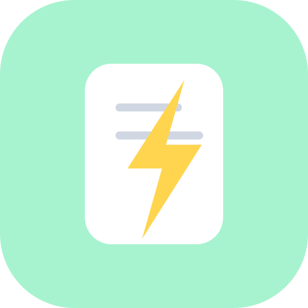
</p>

<h1 align="center">FlashNote</h1>
<p align="center"><strong>AI-Powered Inspiration Capture & Management</strong></p>

<p align="center">
  <a href="https://github.com/SiRan-Dev/FlashNote/releases/latest"></a>
  <a href="LICENSE"></a>
  
  
  
</p>

<p align="center">
  <a href="README_zh.md">Switch to Chinese / 切换到中文</a>
</p>

---

## Screenshots

<p align="center">
  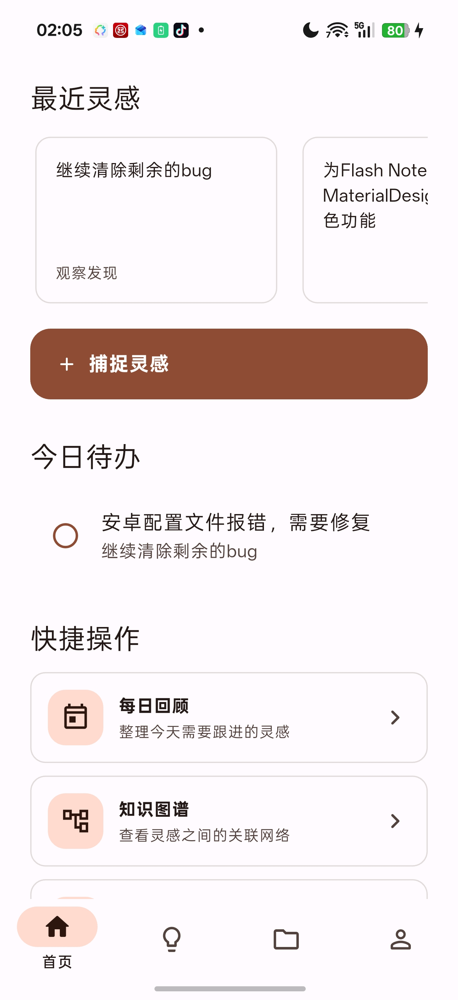
  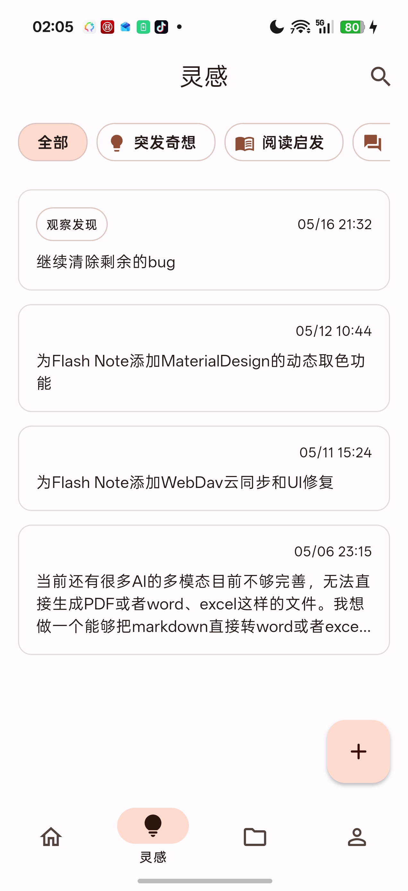
  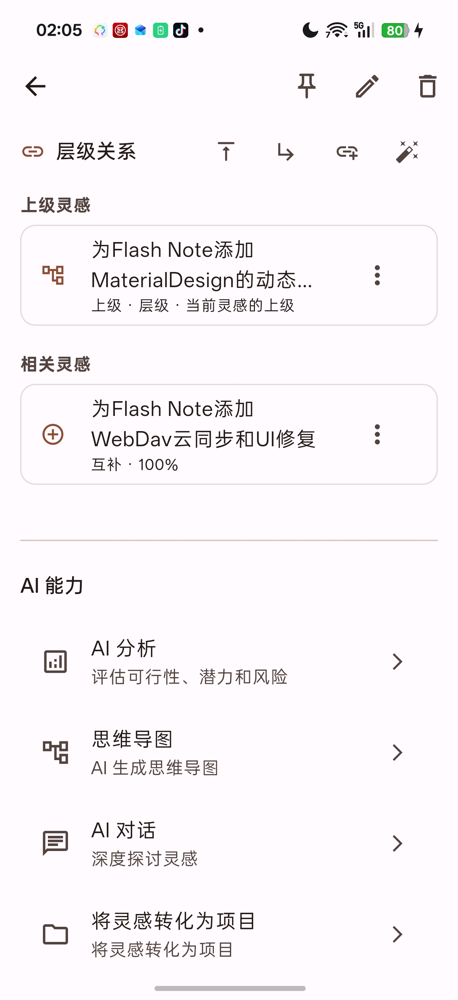
  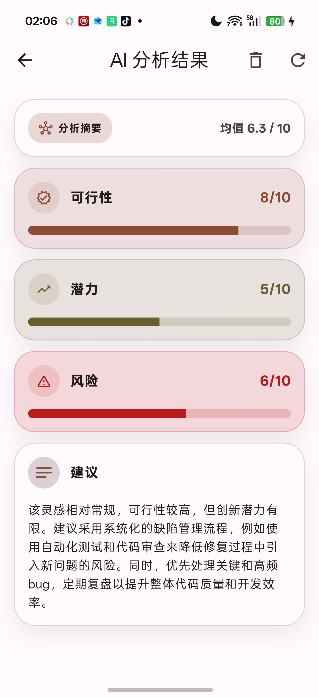
  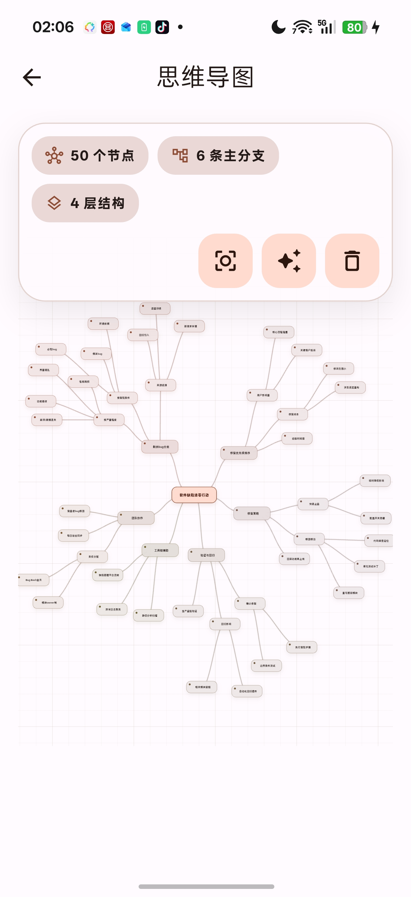
  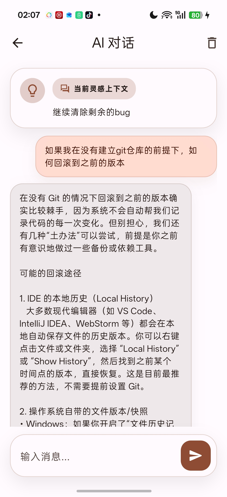
  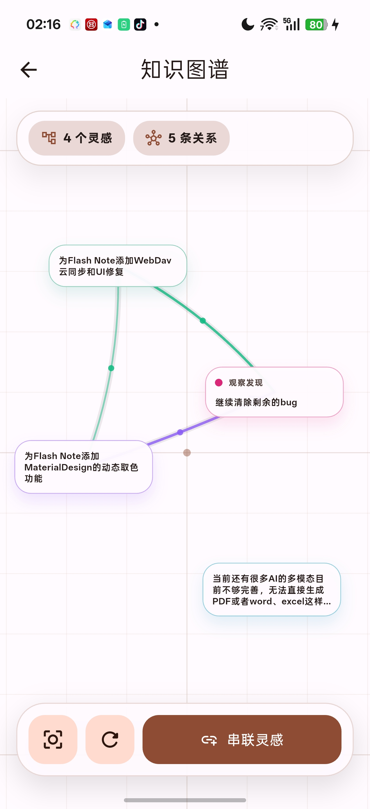
  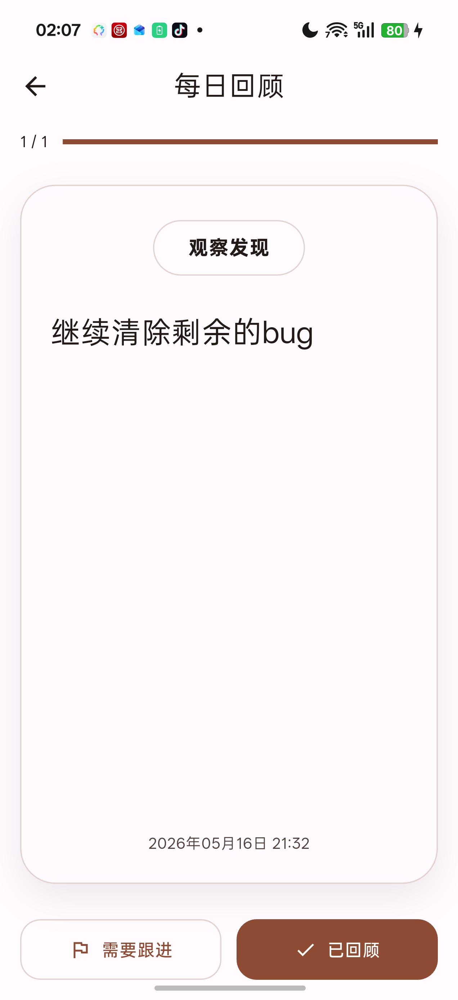
  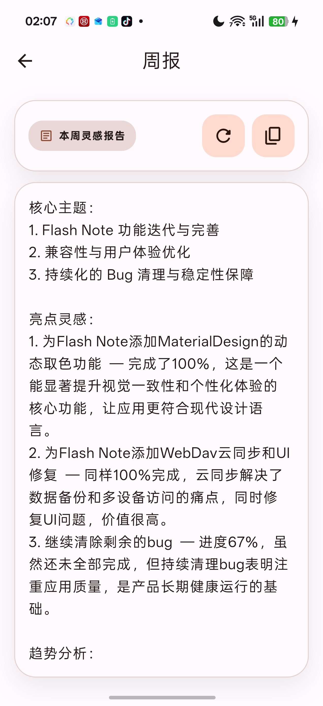
  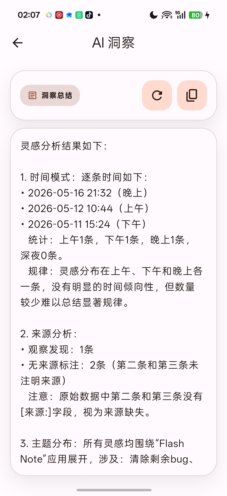
  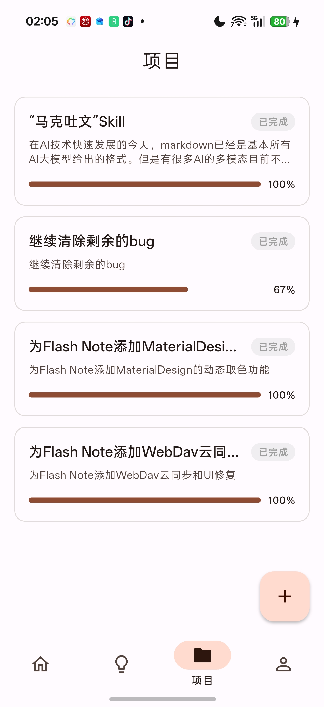
  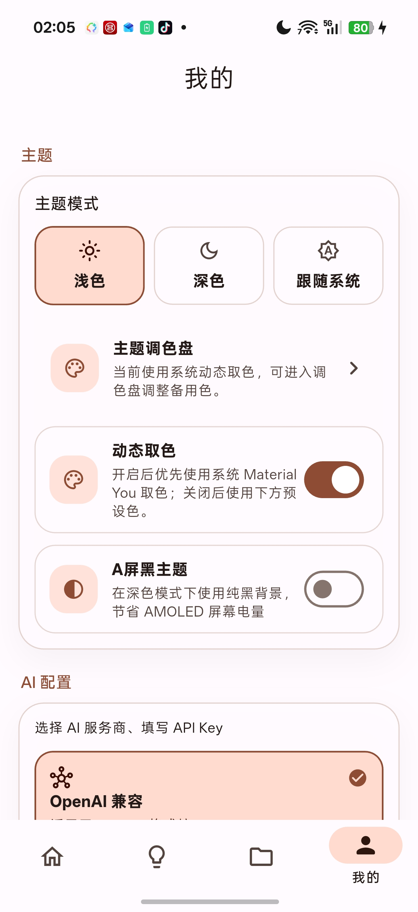
</p>

---

## Features

- Quick capture ideas with tags & source labels
- AI analysis — feasibility, potential, risk & suggestions
- Mind map auto-generation
- AI chat — deep dive into ideas
- Daily review — mark reviewed / needs follow-up
- Weekly / Monthly reports & AI insights
- Inspiration linking — AI discover + manual add
- Knowledge Graph — visual relationships, manual linking, fit view, layout reset
- Project management — convert ideas to projects with tasks
- AI interfaces — OpenAI-compatible and Anthropic-compatible APIs with custom Base URL and model
- Local export/import — backs up ideas, projects, settings, graph layouts, review state, reports, insights, and attachments
- WebDAV cloud sync — pull / push / merge, auto-sync, optional attachment sync
- Import / restore applies immediately without app restart
- Reports and AI insights are persisted locally
- Desktop canvas interactions — hover, right-click menu, middle-drag pan, trackpad zoom, keyboard shortcuts
- Material You dynamic color + AMOLED black theme
- Theme palette — 10 presets, draggable color field, HEX input, light/dark preview
- Light / Dark / System theme
- Cross-platform — Android, iOS, macOS, Windows, Linux, Web

## Getting Started

### Prerequisites

- Flutter SDK >= 3.41.0
- Dart SDK >= 3.7.0

### Install

```bash
git clone https://github.com/SiRan-Dev/FlashNote.git
cd FlashNote
flutter pub get
```

### Generate Code

```bash
dart run build_runner build --delete-conflicting-outputs
```

### Run

```bash
flutter run                  # Android
flutter run -d ios           # iOS
flutter run -d macos         # macOS
flutter run -d windows       # Windows
flutter run -d linux         # Linux
flutter run -d chrome        # Web
```

### Build Release

```bash
flutter build apk --release          # Android APK
flutter build appbundle --release    # Android AAB
flutter build ios --release --no-codesign
flutter build macos --release
flutter build windows --release
flutter build linux --release
flutter build web --release
```

---

## Architecture

```
lib/
├── app/                          # Entry, router, theme
│   └── theme/
├── core/                         # Shared core
│   ├── constants/                # App constants, built-in icons
│   ├── error/                    # Error handling
│   └── utils/                    # Utilities (icon builder, source mapper)
├── data/                         # Data layer
│   ├── datasources/
│   │   ├── local/                # drift DB, SharedPrefs, SecureStorage
│   │   │   ├── connection/       # DB connection per platform
│   │   │   └── tables/           # Drift table definitions
│   │   └── remote/               # AI (OpenAI + Claude), WebDAV client
│   ├── repositories/             # Repository implementations
│   └── services/                 # Export, sync, notification services
├── domain/                       # Domain layer
│   ├── entities/                 # Entities (freezed)
│   ├── repositories/             # Repository interfaces
│   └── services/                 # Service interfaces (AI)
├── l10n/                         # i18n (zh / en)
└── presentation/                 # Presentation layer
    ├── pages/
    │   ├── home/                 # Home page
    │   ├── inspiration/          # Capture, list, detail, AI, graph, review, report
    │   ├── project/              # Project list, detail, create
    │   └── settings/             # Settings, WebDAV, source management
    ├── providers/                # Riverpod Providers
    └── widgets/                  # Shared widgets
```

**Clean Architecture** + **Riverpod** + **drift** + **go_router** + **freezed**

---

## Tech Stack

| Layer | Technology |
|-------|-----------|
| State Management | [Riverpod](https://riverpod.dev/) |
| Routing | [go_router](https://pub.dev/packages/go_router) |
| Database | [drift](https://drift.simonbinder.eu/) (SQLite) |
| Code Gen | [freezed](https://pub.dev/packages/freezed) + [json_serializable](https://pub.dev/packages/json_serializable) |
| HTTP | [dio](https://pub.dev/packages/dio) |
| Secure Storage | [flutter_secure_storage](https://pub.dev/packages/flutter_secure_storage) |
| Cloud Sync | WebDAV |
| AI | OpenAI-compatible API + Anthropic-compatible API (Strategy Pattern) |
| i18n | Flutter ARB (zh / en) |
| Design | Material 3 |

---

## CI/CD

GitHub Actions — triggered by `v*` tag push only:

- Build all platforms
- Auto-publish GitHub Release with all artifacts

Android release signing via GitHub Secrets:

| Secret | Description |
|--------|-------------|
| `ANDROID_KEYSTORE_BASE64` | base64-encoded keystore |
| `ANDROID_STORE_PASSWORD` | Keystore password |
| `ANDROID_KEY_ALIAS` | Key alias |
| `ANDROID_KEY_PASSWORD` | Key password |

---

## License

GPL-3.0 — see [LICENSE](LICENSE)
