<p align="center">
  
</p>

<h1 align="center">闪念 / FlashNote</h1>
<p align="center"><strong>本地优先的灵感收件箱与项目孵化器</strong></p>

<p align="center">
  <a href="https://github.com/SiRan-Dev/Flash-Note/releases/latest"></a>
  <a href="LICENSE"></a>
  
  
  
</p>

<p align="center">
  <a href="README.md">Switch to English / 切换到英文</a>
</p>

---

## 当前状态

当前版本：**v1.3.6（build 72）**，以 `pubspec.yaml` 为准。

| 平台 | 支持级别 | 说明 |
|------|----------|------|
| Android | 一等支持 | GitHub Release 附签名 APK；不发布 AAB |
| Windows | 一等支持 | GitHub Release 附 zip |
| Linux | 一等支持 | GitHub Release 附 zip（CI 在 Ubuntu 上构建） |
| iOS | 实验性 | 仅有 `--no-codesign` 无签名构建；Release 任务是尽力而为，发布产物中可能没有 IPA |
| macOS | 实验性 | 可以编译，但发布构建未签名，且沙盒 entitlement 缺少网络客户端与用户选择文件的读写权限，AI、WebDAV、导入导出可能失败 |
| Web | 不可用 | 当前 `flutter build web` 无法通过：仓库缺少 `web/sqlite3.wasm` 与 `web/drift_worker.js`，且多个服务直接 `import 'dart:io'` |

“一等支持”指 CI 会在每个 tag 发布中构建该平台并附带产物。

## 功能

### 已实现

- **捕捉与整理** —— 快速记录、标签、自定义来源、搜索与来源筛选。
- **附件** —— 灵感或项目可添加任意文件；图片支持全屏预览，其他类型只显示文件名与 MIME 类型（无内嵌视频/PDF 预览）。
- **AI 分析** —— 可行性、潜力、风险与建议。
- **思维导图** —— 由灵感生成，结果随灵感缓存。
- **AI 对话** —— 单条灵感对话；另有全局 AI 助手，会读取可编辑的个人背景与灵感/项目内容。
- **报告** —— 周报、月报、AI 洞察，结果写入 `reports` 表并本地持久化。
- **灵感关联与知识图谱** —— 支持 AI 发现关联与手动关联（相似、因果、补充、对立、父子）；图谱支持手动串联、适配视图、重置布局、节点位置缓存。
- **项目管理** —— 灵感转项目、任务拆分、状态与进度追踪。
- **每日回顾** —— 标记“已回顾”或“需要跟进”。
- **导出 / 导入** —— JSON 备份包含灵感、项目、任务、来源、附件、对话记录、关联、聚类、报告、回顾状态与图谱布局；导入后立即生效，无需重启。导入是覆盖语义，不是合并。
- **WebDAV 同步** —— 拉取、推送、合并；合并按记录 `updatedAt` 取新；可选启动时自动同步；可选同步附件。
- **桌面画布交互** —— hover、右键菜单、中键拖拽、触控板缩放、快捷键。
- **外观** —— Material 3、Material You 动态取色、AMOLED 黑、预设调色盘与可拖动色板/HEX 输入、浅色/深色/跟随系统。
- **语言** —— 中文与英文。
- **存储** —— 本地 SQLite（drift），没有 FlashNote 托管后端。

### 规划中

- 跨设备稳定身份（UUID）。v12 迁移已在 feature 分支实现，但尚未合入 `main`；多设备合并仍可能因自增 ID 冲突而互相覆盖。
- 灵感、项目、报告的 Markdown 导出。
- 灵感与报告的系统分享入口。
- AI 分诊收件箱：对新灵感自动分类、判断是否值得做，并给出行动建议。
- 时间线 / 看板视图与灵感统计。
- 聚类 UI（`clusters` 表与 provider 已存在，但还没有页面使用）。
- 合并式导入（当前导入只有覆盖模式）。
- Web 支持、macOS entitlement/签名、iOS 签名与分发。

## 数据归属与同步安全

- **本地优先** —— 灵感、项目、报告与设置都存放在本地 SQLite 数据库。FlashNote 没有托管后端，AI 请求直接发送到你配置的接口（BYOK）。
- **凭据不出设备** —— API Key 与 WebDAV 密码保存在系统安全存储中。JSON 导出与 WebDAV 快照都会剥离 API Key 和 WebDAV 密码，在新设备恢复后需要重新填写。
- **快照原子发布** —— 同步先写入临时对象，校验大小/ETag 后用 `MOVE` 覆盖正式快照。若服务器不支持 `MOVE`（405/501），降级为双槽位加指针文件，并在写入前后复核指针，避免静默覆盖另一台设备的更新。发布失败时旧快照保持完整。
- **写请求带条件** —— 服务器提供强 ETag 时使用 `If-Match`；弱 ETag 不用于 `If-Match`。写请求不跟随重定向。
- **升级前先备份** —— 原生端在升级数据库前，把数据库及 `-wal`/`-shm` 复制到 `flashnote_backups/vX_to_vY_<时间戳>/`，最后写入 `backup_complete` 标记。备份失败会直接中止启动，不会在没有可恢复副本的情况下升级；迁移在事务中执行，失败时展示带备份路径的恢复页。
- **合并与导入不同** —— 合并同步按记录 `updatedAt` 取新，并携带删除墓碑；导入 JSON 则覆盖本地数据。

## 截图

<p align="center">
  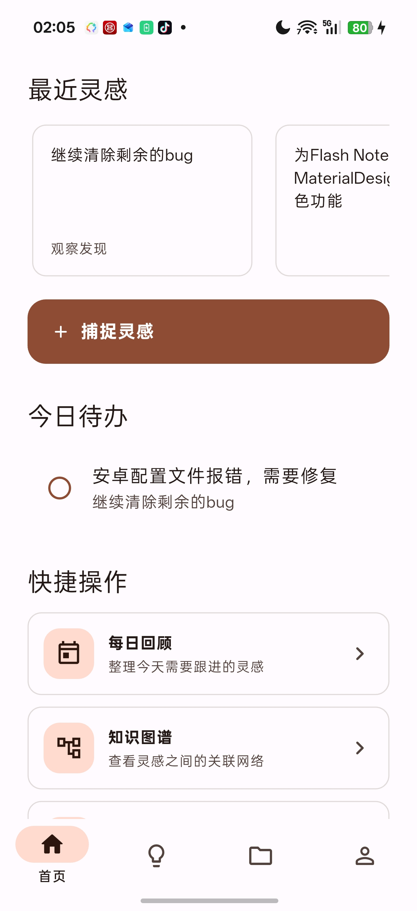
  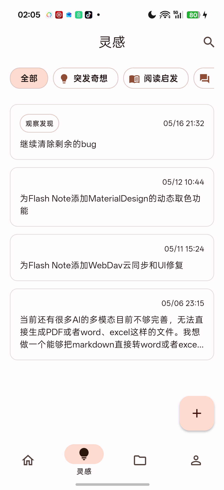
  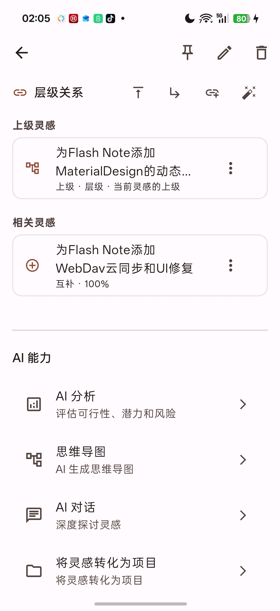
  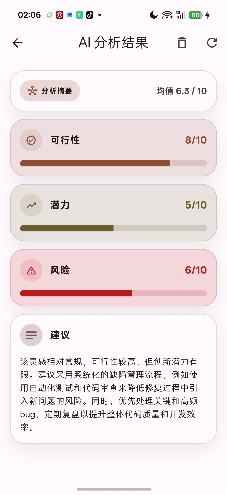
  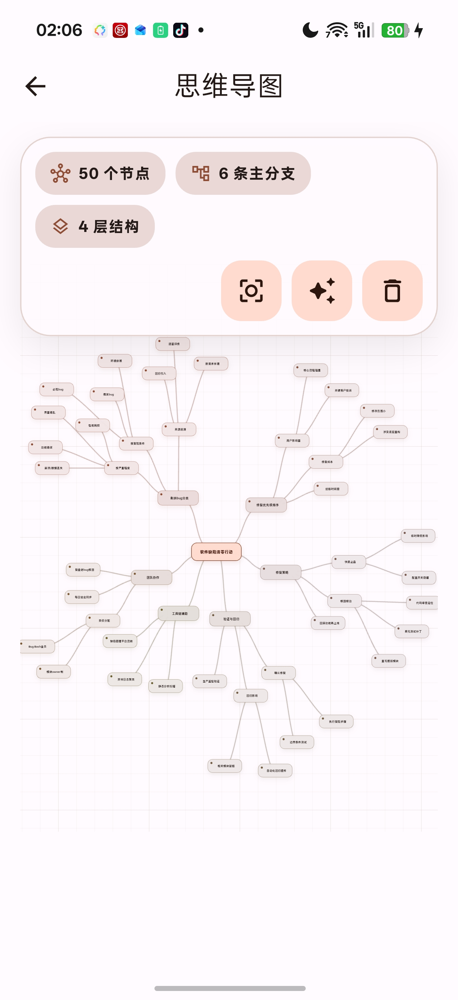
  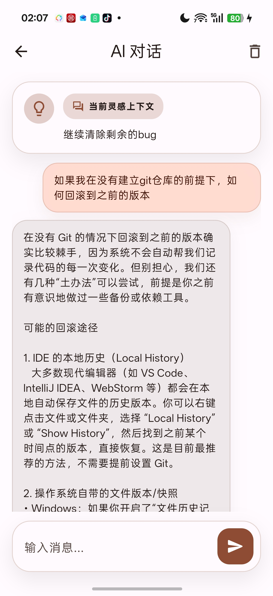
  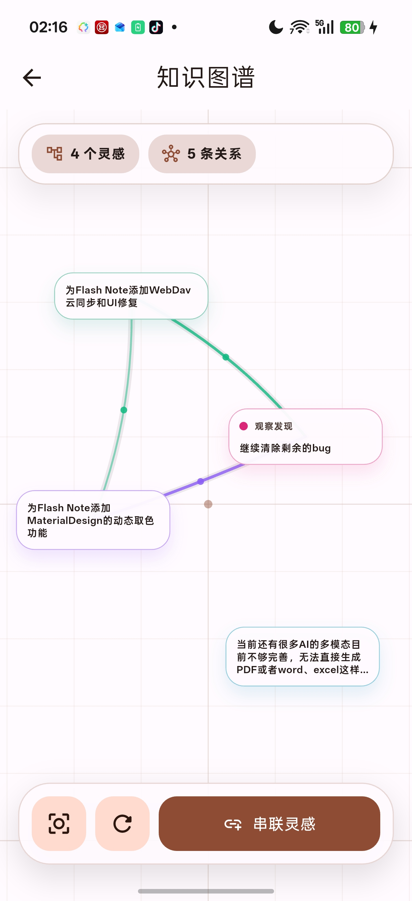
  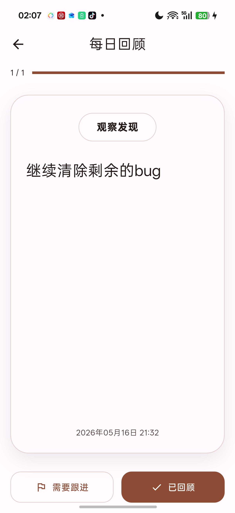
  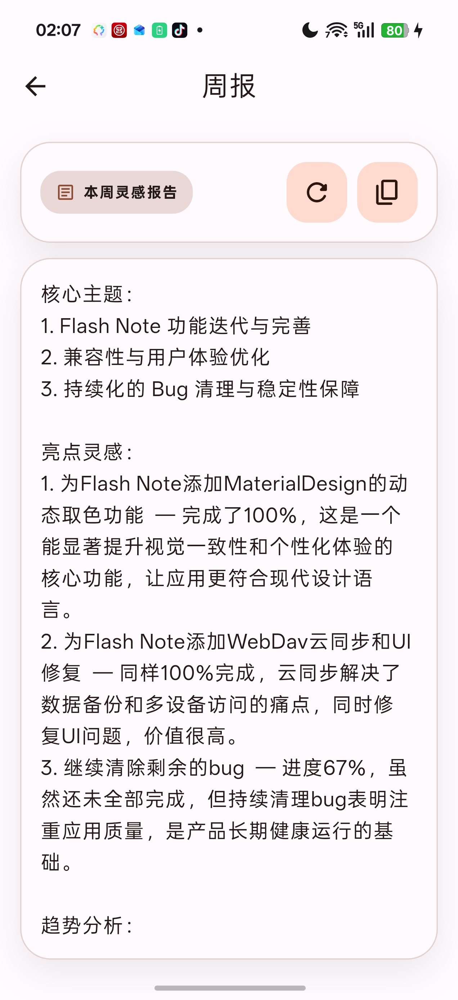
  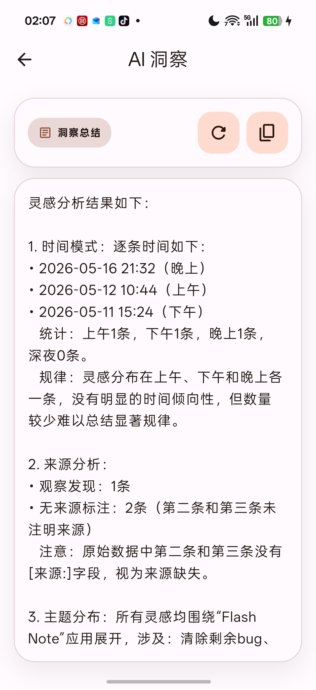
  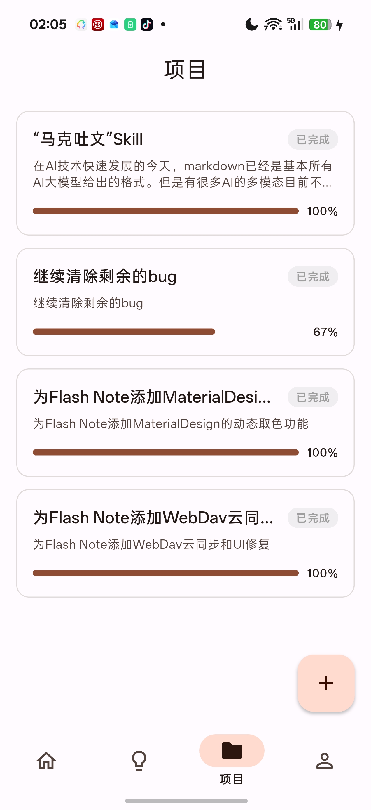
  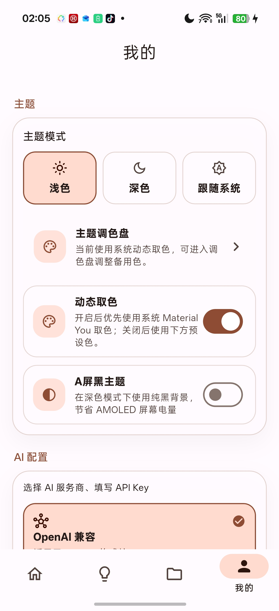
</p>

---

## 快速开始

### 环境要求

- Flutter SDK >= 3.41.0（CI 使用 3.47.1）
- Dart SDK >= 3.8.0

### 安装

```bash
git clone https://github.com/SiRan-Dev/Flash-Note.git
cd Flash-Note
flutter pub get
```

### 生成代码

```bash
dart run build_runner build --delete-conflicting-outputs
```

### 运行

支持的平台：

```bash
flutter run -d android
flutter run -d windows
flutter run -d linux
```

实验性平台：

```bash
flutter run -d ios
flutter run -d macos
```

Web 暂不可运行。`flutter run -d chrome` 会失败：Web SQLite 资源不在仓库中，且多个服务直接 `import 'dart:io'`。

### 构建正式版

支持的平台：

```bash
flutter build apk --release          # Android APK
flutter build windows --release
flutter build linux --release
```

实验性平台：

```bash
flutter build ios --release --no-codesign   # 未签名，没有自己的签名无法安装
flutter build macos --release                # 未签名，且沙盒 entitlement 不完整
```

`flutter build web --release` 暂不可用。

> Android Debug 版包名 `com.sirandev.flashnote.debug`，可与正式版共存。

---

## 架构

```
lib/
├── app/                          # 入口、路由、主题
│   └── theme/
├── core/                         # 共享核心
│   ├── constants/                # 应用常量、内置图标
│   ├── error/                    # 错误处理
│   └── utils/                    # 工具（图标构建器、来源映射器）
├── data/                         # 数据层
│   ├── datasources/
│   │   ├── local/                # drift 数据库、SharedPrefs、SecureStorage
│   │   │   ├── connection/       # 各平台数据库连接、迁移备份
│   │   │   └── tables/           # Drift 表定义
│   │   └── remote/               # AI（OpenAI + Claude）、WebDAV 客户端
│   ├── repositories/             # 仓库实现
│   └── services/                 # 导出、同步、通知服务
├── domain/                       # 领域层
│   ├── entities/                 # 实体（freezed）
│   ├── repositories/             # 仓库接口
│   └── services/                 # 服务接口（AI）
├── l10n/                         # 国际化（中文 / English）
└── presentation/                 # 表现层
    ├── pages/
    │   ├── home/                 # 首页
    │   ├── inspiration/          # 灵感捕捉、列表、详情、AI、图谱、回顾、报告
    │   ├── project/              # 项目列表、详情、创建
    │   └── settings/             # 设置、WebDAV、来源管理
    ├── providers/                # Riverpod Providers
    └── widgets/                  # 通用组件
```

**Clean Architecture** + **Riverpod** + **drift** + **go_router** + **freezed**

---

## 技术栈

| 层级 | 技术 |
|------|------|
| 状态管理 | [Riverpod](https://riverpod.dev/) |
| 路由 | [go_router](https://pub.dev/packages/go_router) |
| 数据库 | [drift](https://drift.simonbinder.eu/) (SQLite) |
| 代码生成 | [freezed](https://pub.dev/packages/freezed) + [json_serializable](https://pub.dev/packages/json_serializable) |
| HTTP | [dio](https://pub.dev/packages/dio) |
| 安全存储 | [flutter_secure_storage](https://pub.dev/packages/flutter_secure_storage) |
| 云同步 | WebDAV |
| AI 服务 | OpenAI 兼容 API + Anthropic 兼容 API（策略模式）|
| 国际化 | Flutter ARB（中文 / English）|
| 设计系统 | Material 3 |

---

## CI/CD

**CI**（`.github/workflows/ci.yml`）在每次 push 和 Pull Request 时运行：

- `flutter pub get`
- `dart run build_runner build`
- `flutter analyze --no-fatal-infos`（warning 与 error 会导致失败）
- `flutter test`

两个工作流都固定使用 Flutter 3.47.1。

**Release**（`.github/workflows/release.yml`）仅在推送 `v*` tag 时运行：

- 构建并发布：签名 Android APK、macOS zip、Windows zip、Linux zip
- iOS 以无签名方式尽力构建，发布产物中可能没有 IPA
- 不构建 Web
- 不发布 AAB

Android 正式版签名通过 GitHub Secrets 配置：

| Secret | 说明 |
|--------|------|
| `ANDROID_KEYSTORE_BASE64` | base64 编码的密钥库 |
| `ANDROID_STORE_PASSWORD` | 密钥库密码 |
| `ANDROID_KEY_ALIAS` | 密钥别名 |
| `ANDROID_KEY_PASSWORD` | 密钥密码 |

---

## 许可证

GPL-3.0 — 详见 [LICENSE](LICENSE)
